# Don Guerra

## 1. Descripción breve

**Don Guerra** es una app móvil (Flutter) para una tienda de **cerámica artesanal** del norte de Guanajuato. Permite explorar el catálogo de piezas, solicitar pedidos (simples o **personalizados** con color, grabado y fecha deseada) y dar seguimiento al trabajo artesanal: *Solicitud recibida → En elaboración → Terminado → Entregado*.

## 2. Los 3 tipos de usuario y sus dashboards

| Rol | Cuenta de prueba | Dashboard | Qué hace |
|---|---|---|---|
| **Administrador** | `admin@donguerra.com` / `Admin123` | Resumen · Productos · Usuarios | Ve métricas del negocio, da de alta/edita/elimina productos (**formulario de producto**) y consulta usuarios registrados. |
| **Artesano** | `artesano@donguerra.com` / `Artesano123` | Resumen · Pedidos | Ve las solicitudes entrantes, filtra por estado y actualiza el avance (**formulario de actualización de pedido**: estado, precio, fecha estimada, nota). |
| **Cliente** | `cliente@donguerra.com` / `Cliente123` | Inicio · Catálogo · Pedidos · Perfil | Explora el catálogo, solicita piezas (**formulario de pedido personalizado**) y sigue el estado de sus pedidos. |

También se pueden crear cuentas nuevas desde **Registro** (eligiendo el rol).

**Listas con datos dinámicos y estado vacío**

- Lista principal: **Catálogo** (búsqueda + filtro por categoría; la categoría *Personalizados* muestra el estado vacío "No hay elementos").
- Lista secundaria: **Mis pedidos** (cliente nuevo → estado vacío) y **Pedidos** del artesano; además, el admin ve **Productos** y **Usuarios**.

## 3. Manejo de estado elegido (y por qué)

Se usó **Provider** (`ChangeNotifier`) con tres proveedores:

- `AuthProvider`: sesión, usuarios y rol actual.
- `CatalogProvider`: productos (alta, edición, baja y descuento de stock).
- `OrdersProvider`: pedidos y su estado.

**Por qué:** es la solución recomendada por Flutter para apps de tamaño pequeño/mediano, evita pasar datos manualmente entre pantallas y hace que las listas y dashboards se actualicen solos con `context.watch`. Gracias a esto **el estado persiste al navegar**: un pedido creado por el cliente aparece de inmediato al artesano y al administrador, y cuando el artesano cambia el estado, el cliente lo ve actualizado. (Los datos viven en memoria mientras la app está abierta.)

## 4. Cómo ejecutar la app

```bash
flutter pub get
flutter run
```

Para ubicar cada archivo, consulta [ESTRUCTURA_DEL_PROYECTO.md](ESTRUCTURA_DEL_PROYECTO.md).

Requisitos: Flutter instalado y un emulador o dispositivo conectado (`flutter devices`). Al abrir, la app muestra el **splash** (3 s) y pasa al **login**.

## 5. Demostración al docente

- Dispositivo/emulador usado: **[completar: Android/iOS · modelo/versión]**
- Fecha y modalidad de la demostración: **[completar: presencial / videollamada]**

## 6. Screenshots

### Splashscreen
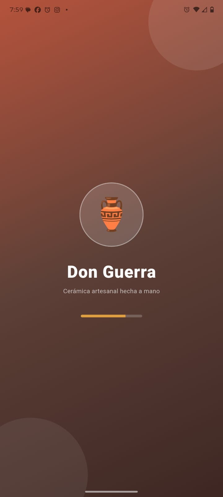

### Autenticación
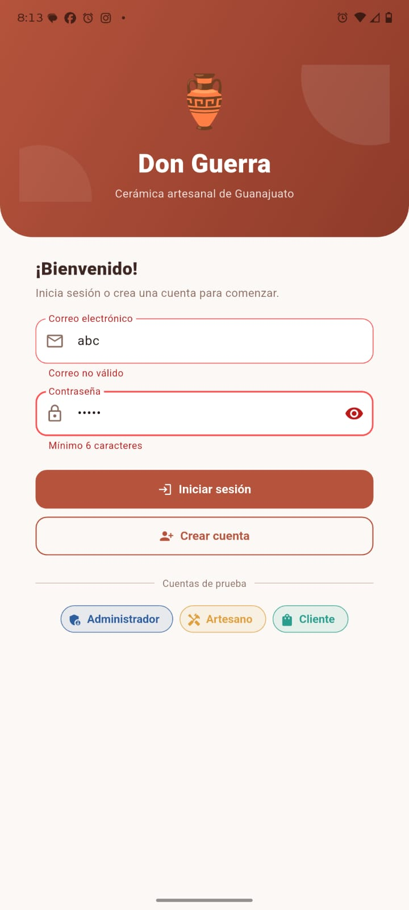
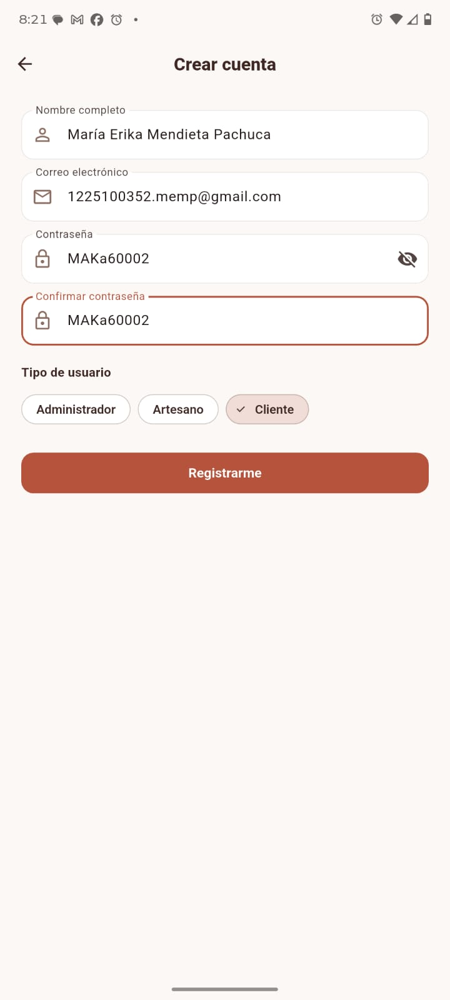

### Dashboards
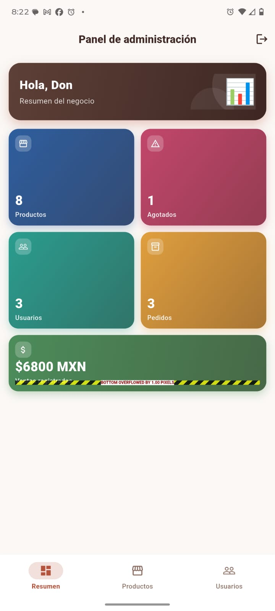
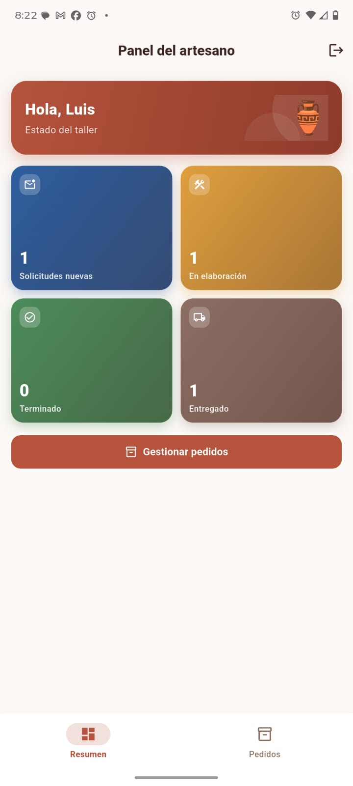
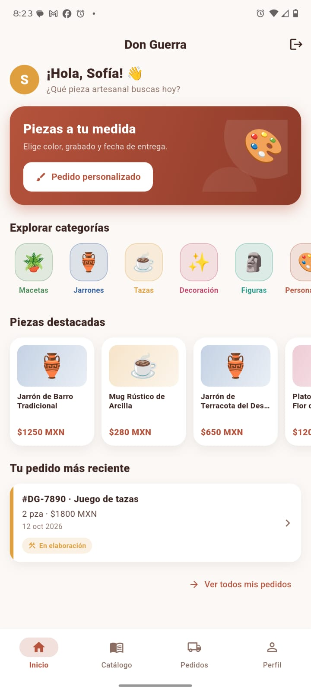

### Listas
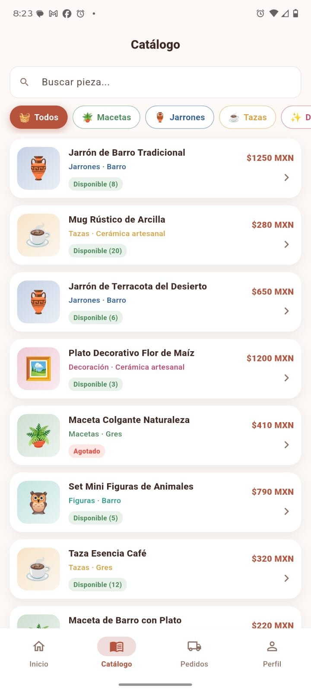
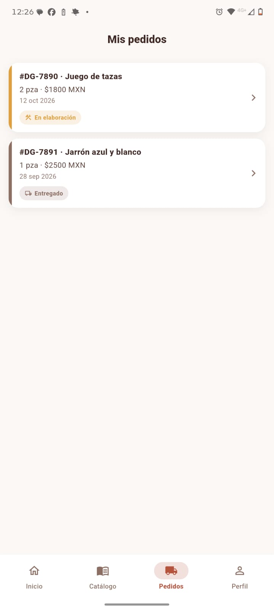
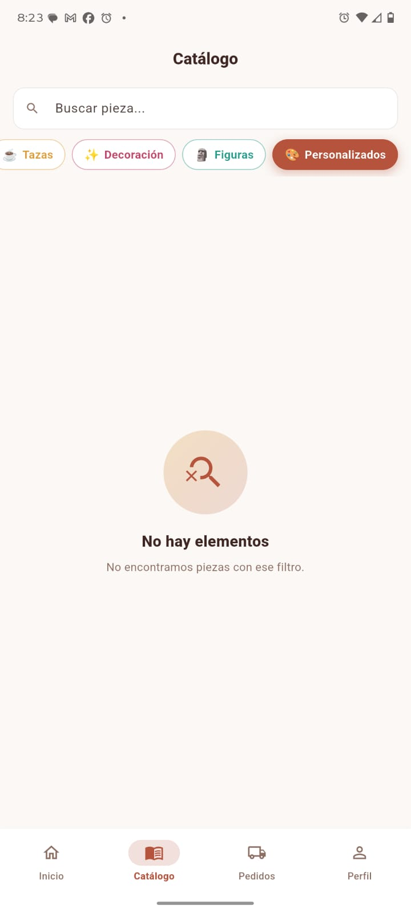

### Formularios
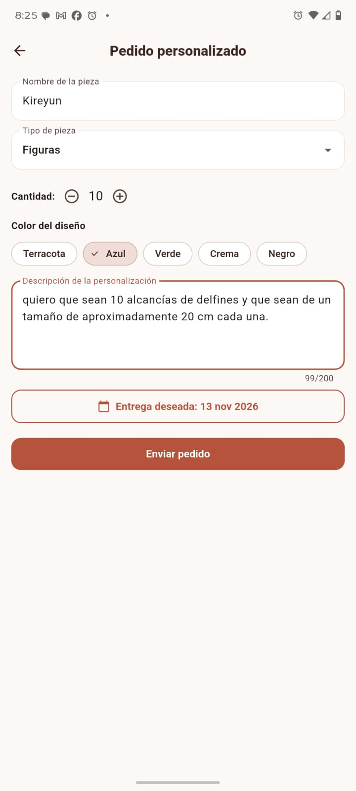
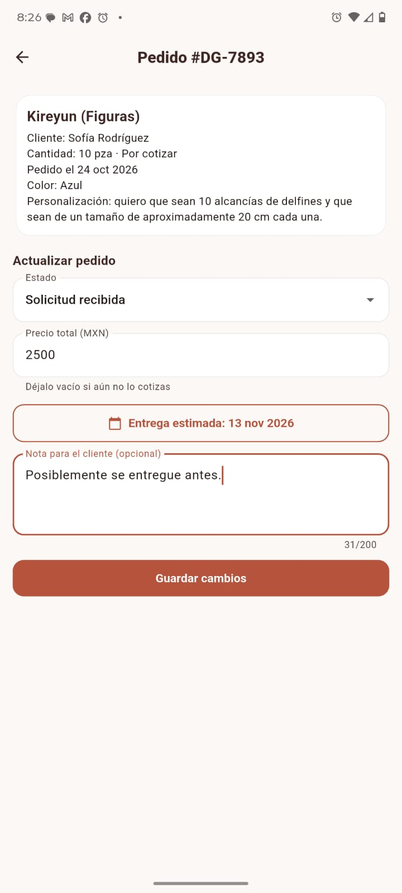
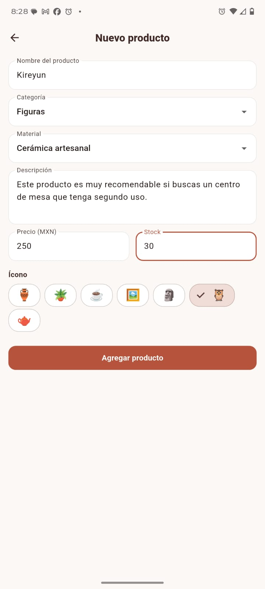

### Evidencia funcional


